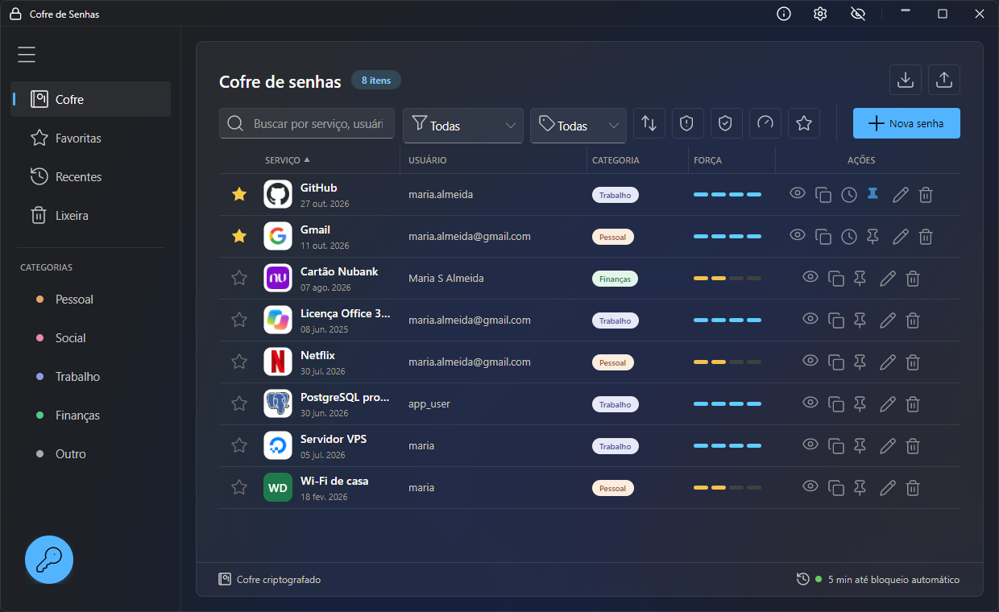
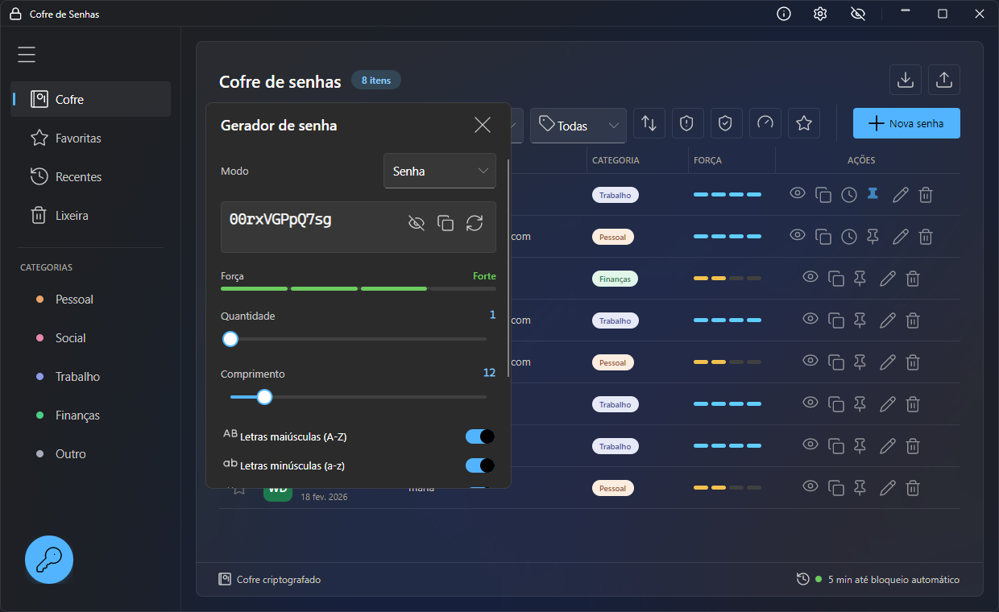
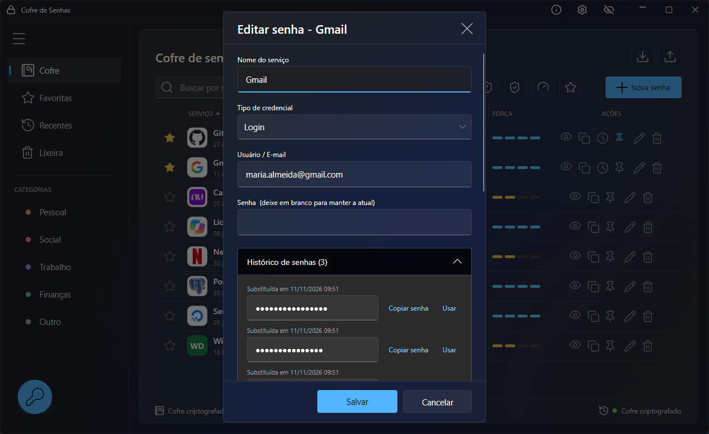
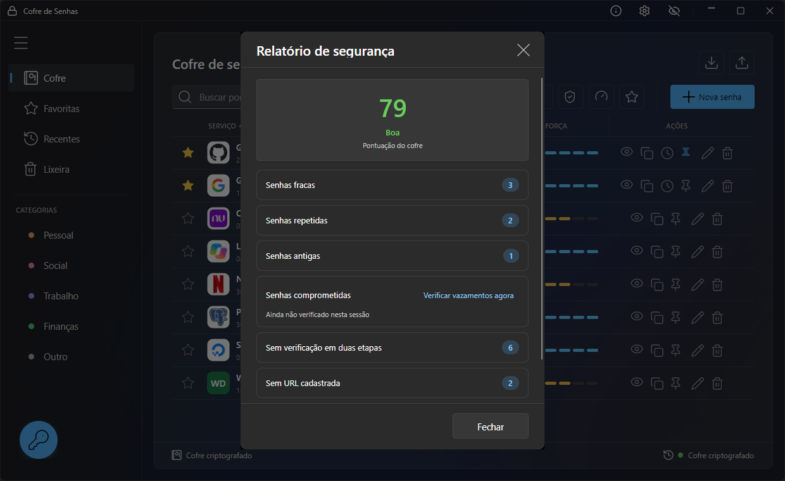
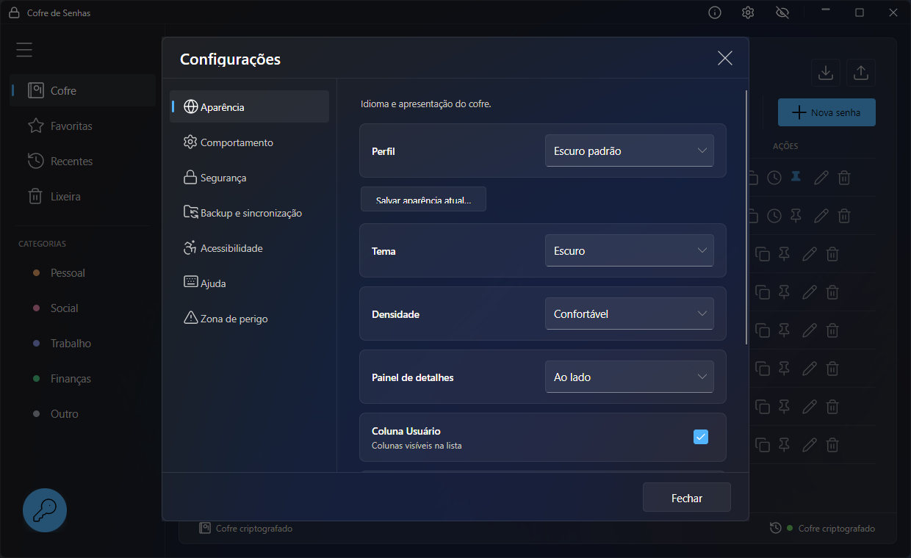
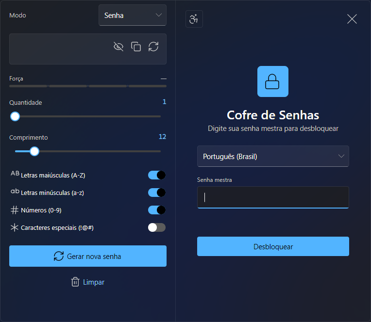

# Cofre de Senhas

🇧🇷 Português | [🇺🇸 English](README.en.md)

Gerenciador de senhas multiplataforma (Windows e Linux): gerador de senhas
integrado, cofre local criptografado (AES-256-GCM) e sincronização opcional
entre dispositivos ou com um banco de dados externo. Código aberto e
gratuito — desenvolvido em C# com .NET 10 e Avalonia.

Distribuído sob a licença [MIT](LICENSE) — uso, estudo, modificação e
redistribuição livres para qualquer finalidade, desde que o aviso de copyright
e a licença acompanhem as cópias.

## Interface

A interface foi redesenhada para ser mais leve e direta. As superfícies são
translúcidas e deixam o fundo da área de trabalho aparecer de leve; os tons
neutros não competem com o que importa, que são as suas credenciais. A
tipografia é limpa, os ícones têm traço fino e os cantos e espaçamentos
seguem um mesmo ritmo em todas as telas.

O contexto ficou mais fácil de ler de relance: cada credencial pode mostrar o
ícone do próprio serviço (opcional, baixado só se você ativar), a força da
senha aparece em barras coloridas na lista, e o item ativo da navegação é
marcado por uma barra discreta na cor de destaque. Os campos sublinham em
destaque quando recebem o foco e as janelas secundárias mantêm o mesmo visual
da principal.

Tema claro e escuro, alto contraste, paletas para daltonismo e escala de
texto continuam disponíveis em **Configurações > Aparência** e
**Acessibilidade**.

| | |
|:---:|:---:|
|  |  |
| Gerador de senhas integrado | Edição com histórico de senhas |
|  |  |
| Relatório de segurança | Configurações |

   
  Tela de desbloqueio, com o gerador sempre à mão

## Baixe e instale

- **Windows**: `winget install dcCarreto.CofreDeSenhas`, ou baixe e rode
  `CofreDeSenhas-Setup-*.exe` (instalador, não exige administrador) ou
  `CofreDeSenhas.exe` (portátil) na [última release](../../releases/latest).
- **Linux**: baixe `CofreDeSenhas-*-x86_64.AppImage` na
  [última release](../../releases/latest), dê permissão de execução e rode.

Passo a passo completo, linha de comando `cofre` e verificação de integridade
dos arquivos em [docs/INSTALACAO.md](docs/INSTALACAO.md).

## Saiba mais

- [Sobre o projeto e o código aberto](docs/SOBRE.md) — motivação e filosofia
  do projeto.
- [Funcionalidades](docs/FUNCIONALIDADES.md) — lista completa, por área, com
  capturas de tela.
- [Modelo de segurança](docs/SEGURANCA.md) — algoritmos e parâmetros
  criptográficos usados.
- [Modelo de ameaça](THREAT_MODEL.md) — o que é protegido, contra que tipo de
  atacante, e o que fica deliberadamente fora de escopo.
- [Política de segurança](SECURITY.md) — como reportar uma vulnerabilidade.
- [Política de privacidade](PRIVACY.md) — que dados o aplicativo guarda, o que
  vai para a rede (e quando) e como apagar tudo.
- [Download e instalação](docs/INSTALACAO.md) — Windows, Linux, CLI e
  verificação de integridade.
- [Arquitetura e tecnologias](docs/ARQUITETURA.md) — estrutura do projeto,
  camadas e stack.
- [Compilando e testando](docs/DESENVOLVIMENTO.md) — rodar, testar e gerar o
  executável/instalador a partir do código-fonte.
- [Armazenamento de dados](docs/ARMAZENAMENTO.md) — onde e como os arquivos
  do cofre ficam gravados.
- [Como contribuir](CONTRIBUTING.md).
- [Licença](LICENSE) — MIT.

Os binários do Windows ainda não têm certificado de assinatura de código
(Authenticode) — veja em [SECURITY.md](SECURITY.md#confiança-nos-binários-e-verificação-dos-downloads)
o porquê e como verificar a autenticidade do que foi baixado por outros meios.
