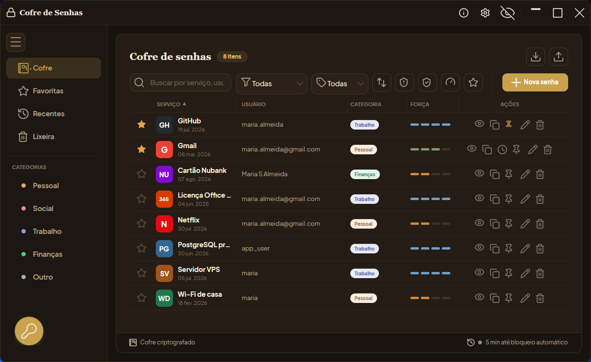

# Cofre de Senhas

🇧🇷 Português | [🇺🇸 English](README.en.md)

Gerenciador de senhas multiplataforma (Windows e Linux): gerador de senhas
integrado, cofre local criptografado (AES-256-GCM) e sincronização opcional
entre dispositivos ou com um banco de dados externo. Código aberto, gratuito
e sem fins comerciais — desenvolvido em C# com .NET 10 e Avalonia.

Distribuído sob a licença [PolyForm Noncommercial 1.0.0](LICENSE) — uso,
estudo, modificação e redistribuição livres para qualquer finalidade não
comercial.

## Baixe e instale

- **Windows**: baixe e rode `CofreDeSenhas-Setup-*.exe` (instalador, não exige
  administrador) ou `CofreDeSenhas.exe` (portátil) na
  [última release](../../releases/latest).
- **Linux**: baixe `CofreDeSenhas-*-x86_64.AppImage` na
  [última release](../../releases/latest), dê permissão de execução e rode.

Passo a passo completo, linha de comando `cofre` e verificação de integridade
dos arquivos em [docs/INSTALACAO.md](docs/INSTALACAO.md).

## Saiba mais

- [Sobre o projeto e o código aberto](docs/SOBRE.md) — motivação e filosofia
  do projeto.
- [Funcionalidades](docs/FUNCIONALIDADES.md) — lista completa, por área, com
  capturas de tela.
- [Modelo de segurança](docs/SEGURANCA.md) — algoritmos e parâmetros
  criptográficos usados.
- [Modelo de ameaça](THREAT_MODEL.md) — o que é protegido, contra que tipo de
  atacante, e o que fica deliberadamente fora de escopo.
- [Política de segurança](SECURITY.md) — como reportar uma vulnerabilidade.
- [Download e instalação](docs/INSTALACAO.md) — Windows, Linux, CLI e
  verificação de integridade.
- [Arquitetura e tecnologias](docs/ARQUITETURA.md) — estrutura do projeto,
  camadas e stack.
- [Compilando e testando](docs/DESENVOLVIMENTO.md) — rodar, testar e gerar o
  executável/instalador a partir do código-fonte.
- [Armazenamento de dados](docs/ARMAZENAMENTO.md) — onde e como os arquivos
  do cofre ficam gravados.
- [Como contribuir](CONTRIBUTING.md).
- [Licença](LICENSE) — PolyForm Noncommercial 1.0.0.

Os binários do Windows ainda não têm certificado de assinatura de código
(Authenticode) — veja em [SECURITY.md](SECURITY.md#confiança-nos-binários-e-verificação-dos-downloads)
o porquê e como verificar a autenticidade do que foi baixado por outros meios.
