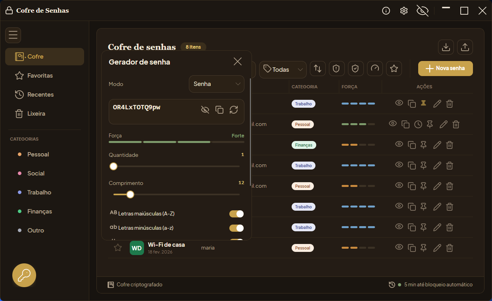
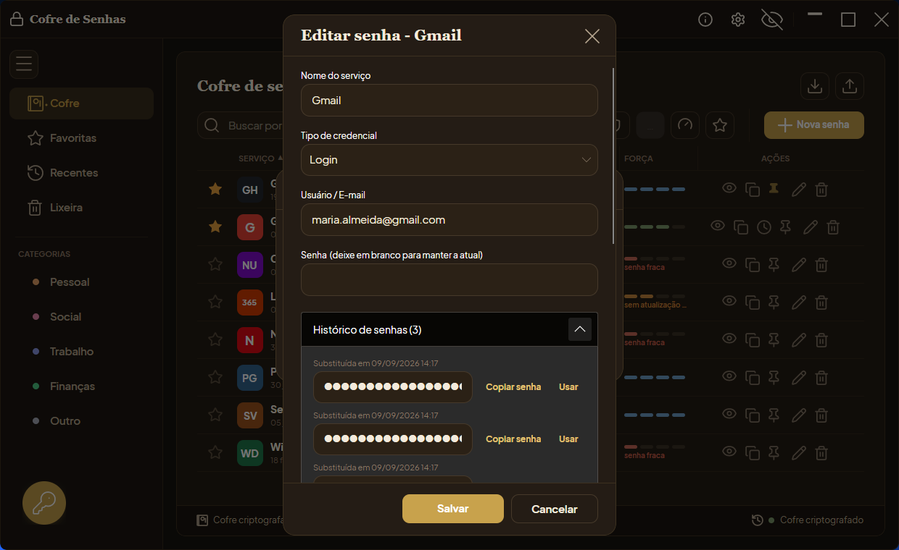
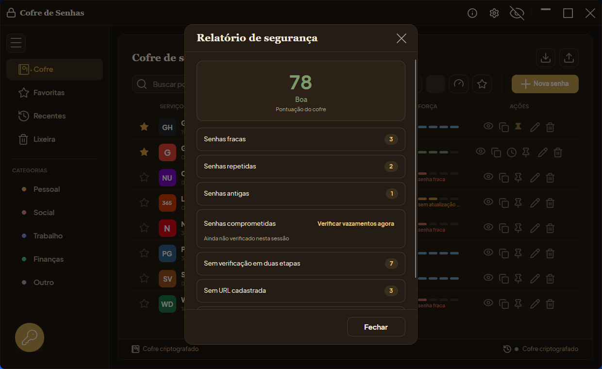
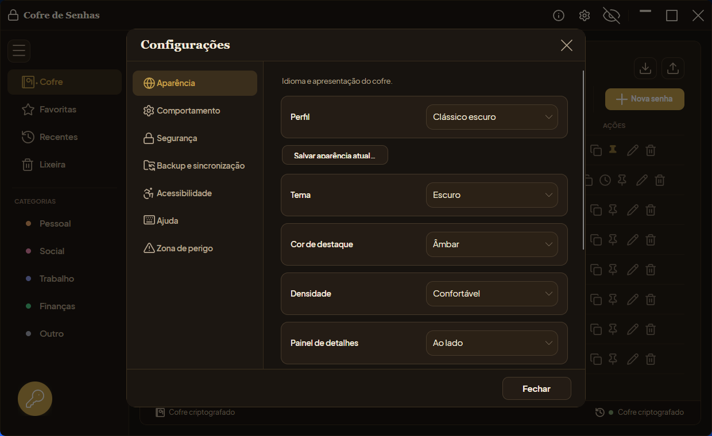

# Funcionalidades

[← Voltar ao README](../README.md)

Lista completa de funcionalidades do Cofre de Senhas, por área. Para um resumo
curto, veja a seção [Funcionalidades](../README.md#funcionalidades) do README.

## Gerador de senhas

- Comprimento ajustável de 4 a 64 caracteres.
- Seleção dos tipos de caractere: maiúsculas, minúsculas, números e símbolos.
- Modo de frases-senha (passphrases) a partir de lista de palavras, com
  quantidade de palavras, separador, capitalização e número final configuráveis.
- Indicador visual de força em tempo real.
- Geração de várias senhas de uma só vez, com a quantidade configurável.
- Área de senha gerada flexível: senhas longas e múltiplas senhas expandem o
  campo verticalmente e empurram os demais controles para baixo, com rolagem no
  painel esquerdo quando necessário.
- Geração baseada em um gerador de números aleatórios criptográfico
  (`RandomNumberGenerator`), e não em um gerador pseudoaleatório comum.
- Disponível também na tela de senha mestra, antes do desbloqueio: dá para gerar
  e copiar senhas sem abrir o cofre, com a opção de salvar surgindo somente após
  a autenticação.

O painel do gerador, com a senha gerada, o indicador de força e as opções de
caractere:

## Cofre de senhas

- Cadastro, edição e remoção de credenciais, com os campos de serviço, usuário,
  senha, URL, categoria, etiquetas, notas e marcação de favorito.
- Tipos de credencial: além do login padrão, seis modelos prontos (Cartão,
  Chave de licença, Wi-Fi, Servidor, Banco de dados, além do próprio Login),
  cada um renomeando os campos para o vocabulário certo e mostrando campos
  extras próprios (cartão: validade, CVV, bandeira; Wi-Fi: segurança, banda;
  servidor/banco de dados: host, porta e mais alguns), todos cifrados
  individualmente.
- Códigos TOTP (autenticação em duas etapas) por entrada: cole a chave secreta
  (Base32) ou um link `otpauth://` e o cofre gera o código de seis dígitos
  localmente, com prévia ao vivo e contagem regressiva na criação e edição, além
  de cópia por um clique na lista.
- Códigos de recuperação por credencial: cole um ou mais códigos de backup (um
  por linha), cada um copiável individualmente, marcável como usado ou
  removível, sempre ocultos por padrão como as senhas.
- Categorias predefinidas (Trabalho, Pessoal, Finanças, Social e Outro), com
  categoria personalizada quando `Outro` é selecionada, e etiquetas livres que
  valem para qualquer categoria, com múltiplas por credencial.
- Busca em tempo real por serviço, usuário ou categoria personalizada, com
  filtros por categoria e por etiqueta combináveis entre si e com os filtros de
  favoritos e auditoria.
- Barra lateral de navegação com atalhos para o cofre completo, os favoritos, os
  itens recentes, a lixeira e cada categoria.
- Lixeira criptografada: excluir uma credencial move para a lixeira em vez de
  apagar na hora, com a data da exclusão exibida. Da lixeira dá para restaurar,
  excluir em definitivo ou esvaziar tudo de uma vez, sempre com confirmação
  antes de qualquer exclusão definitiva.
- Indicador de força por senha armazenada.
- Ações em lote: selecionar várias credenciais de uma vez (`Ctrl`+clique em
  cada linha) libera uma barra com atalhos para favoritar, adicionar uma
  etiqueta ou mover todas para a lixeira de uma só vez.
- Relatório de segurança do cofre: pontuação geral (0 a 100) calculada a partir
  de senhas fracas, repetidas, antigas e comprometidas, além de contas sem
  autenticação em duas etapas, sem URL ou sem categoria. Cada linha do relatório
  pode ser clicada para filtrar a lista principal por aquele problema, e um
  pequeno gráfico mostra a tendência da pontuação nos últimos dias. A
  verificação de vazamento (Have I Been Pwned, por k-anonymity) é disparada pela
  própria tela e continua opcional; o restante é sempre calculado localmente.
- Histórico de senhas por credencial: a cada troca, a senha anterior é guardada
  de forma cifrada com a data da substituição, podendo ser revelada, copiada ou
  reutilizada na tela de edição. As últimas dez versões são mantidas.
- Anexos criptografados: até 5 arquivos por credencial (5 MB cada, 100 MB no
  total do cofre), cada um cifrado individualmente (AES-256-GCM) e guardado à
  parte do cofre principal. Ficam só no dispositivo local, sem sincronizar para
  bancos de dados conectados.
- Lista com ícones por serviço, categoria e ações rápidas para revelar, copiar,
  fixar no topo e editar.
- Cabeçalhos da lista clicáveis para ordenar por serviço, usuário, categoria ou
  força, com indicação da coluna e do sentido ativos.
- Colunas redimensionáveis para serviço, usuário, categoria, data e ações, com
  redistribuição proporcional da largura ao redimensionar a janela.
- Edição inline do nome do serviço diretamente na lista.
- Cópia do usuário com um clique na coluna `Usuário`, exibindo confirmação
  visual temporária na linha.
- Digitação automática (Windows): no painel de detalhes de uma credencial,
  preenche usuário e senha (nessa ordem, separados por Tab, sem Enter) na
  última janela externa que esteve em primeiro plano antes do cofre — a
  pessoa alterna para o formulário de login, volta ao cofre e aciona. Sempre
  pede confirmação nomeando a janela e o processo alvo antes de digitar, e
  aborta sem enviar nada se essa janela não estiver mesmo em foco no momento.
- Atalhos de teclado para as ações mais frequentes (`Ctrl+F` busca, `Ctrl+N`
  nova senha, `Ctrl+G` gerador, `Ctrl+L` bloqueia o cofre na hora, `Ctrl+H`
  modo privacidade, `Ctrl+Shift+U`/`Ctrl+Shift+P` copiam usuário/senha da linha
  em foco), com folha consultável em Configurações → Ajuda → "Atalhos de
  teclado...".

A edição de uma credencial reúne serviço, usuário, senha, URL, categoria e notas,
com o código TOTP calculado ao vivo e o histórico das senhas anteriores:

A auditoria marca na própria lista as senhas fracas, repetidas ou sem atualização
há muito tempo, e o relatório de segurança reúne tudo numa pontuação geral do
cofre, tudo calculado localmente e sem enviar nada para fora:

## Segurança e autenticação

- Senha mestra exigida na criação do cofre e em cada abertura.
- Limite de tentativas de desbloqueio, com bloqueio temporário após falhas
  sucessivas.
- Bloqueio automático após período de inatividade, configurável no menu de
  configurações (desativado, 1, 5, 15 ou 30 minutos), voltando à tela de senha
  mestra.
- Desbloqueio por Windows Hello/biometria no Windows, com ativação por
  dispositivo e senha mestra como fallback.
- Alteração da senha mestra pelo menu de configurações, com re-criptografia
  automática de todo o cofre e backup com rollback em caso de falha.
- Mensagens de erro traduzidas para o idioma ativo em vez de texto técnico cru
  (senha, geração, exportação, importação, troca de senha mestra, anexos,
  persistência local). O erro original continua registrado num log de
  diagnóstico rotativo em disco (limitado a 1 MB) para investigação.
- Zona de risco no menu de configurações: "Limpar cofre" move todas as
  credenciais para a lixeira (reversível) e "Excluir cofre" apaga em definitivo
  o cofre local, os anexos, a senha mestra e a credencial biométrica associada
  — sempre com reautenticação pela senha mestra antes de confirmar.

## Backup e recuperação

- Backup automático local: frequência configurável (manual, diário ou semanal),
  quantidade máxima de backups mantidos (5, 10 ou 20) e backup manual a
  qualquer momento, na tela "Backup e restauração..." do menu de
  configurações. Qualquer backup listado pode ser restaurado, sempre com aviso
  e confirmação antes de substituir o cofre atual. Os backups permanecem
  sempre cifrados.
- Exportação e importação do cofre em um arquivo portável (`.gsenhas`), protegido
  por uma senha de exportação independente da senha mestra. Com um filtro
  ativo na lista (busca, categoria, etiqueta ou favoritos), a tela de
  exportação oferece exportar só os itens filtrados em vez do cofre inteiro.
- Importação de arquivos CSV de outros gerenciadores (Bitwarden, LastPass,
  1Password, Chrome/Edge, Firefox, KeePass, Dashlane, NordPass e formatos
  genéricos), com detecção automática de delimitador e mapeamento das colunas
  pelo cabeçalho, preservando segredos TOTP e favoritos. Um campo inválido
  numa linha conta só aquela linha como inválida, sem abortar o restante do
  lote.
- Geração opcional de um QR code de backup da senha mestra, oferecido na criação
  do cofre e a cada alteração da senha mestra. O QR code mostra uma versão em
  senha-frase da senha mestra, e não a senha original caractere a caractere.
  Salvar o arquivo dentro de uma pasta sincronizada com a nuvem (OneDrive,
  Dropbox, Google Drive, iCloud Drive) mostra um aviso extra antes de gravar.
- Chave de recuperação opcional (desligada por padrão): oferecida na criação
  do cofre e disponível a qualquer momento em Configurações → Segurança. Gera
  um segredo de 160 bits (formatado em grupos de 4 caracteres) que decifra a
  chave mestra guardada num envelope próprio — anote-o e guarde-o longe do
  dispositivo, ele vale tanto quanto a própria senha mestra. Esquecendo a
  senha mestra, a tela de login oferece "Esqueci a senha mestra": com o
  segredo em mãos, define-se uma senha nova e o cofre é re-cifrado com ela;
  o segredo antigo é substituído por um novo a cada uso ou troca de senha
  mestra. Ativar, gerar de novo ou desativar sempre exige a senha mestra
  atual, mesmo com o cofre já desbloqueado.

## Sincronização entre dispositivos (pasta compartilhada)

- O item "Sincronização..." no menu de configurações liga o cofre a outros
  dispositivos através de uma pasta compartilhada (Dropbox, OneDrive, Google
  Drive ou qualquer pasta sincronizada por outro meio) — o aplicativo só lê e
  escreve um arquivo cifrado ali dentro, sem falar diretamente com nenhum
  provedor.
- A chave de sincronização deriva da própria senha mestra (mesma senha em
  todos os dispositivos), e os dados saem cifrados com AES-256-GCM (chave
  derivada por Argon2id) antes de qualquer gravação: o provedor de nuvem
  nunca vê texto puro.
- Sincroniza ao desbloquear, em intervalo configurável (5 a 60 minutos) ou sob
  demanda; sem pasta acessível, o cofre continua funcionando 100% local. A
  maioria dos campos usa a edição mais recente por credencial inteira,
  incluindo exclusão e restauração da lixeira; etiquetas e histórico de senha
  são exceção e somam as mudanças dos dois lados em vez de um substituir o
  outro. Anexos ainda não sincronizam por essa via.
- Pensada para sincronizar os seus próprios dispositivos sem manter um banco de
  dados — para compartilhar o cofre com outras pessoas de confiança ou
  hospedar você mesmo o armazenamento, use a conexão a banco de dados externo,
  abaixo.

## Banco de dados externo (self-hosted/compartilhado)

- Conexão a um banco de dados externo pelo menu de configurações, com suporte a
  SQLite, PostgreSQL, MySQL/MariaDB e SQL Server, e teste de conexão. Pensado
  para uso self-hosted ou compartilhado com outras pessoas de confiança — para
  sincronizar só os seus próprios dispositivos, sem manter um banco de dados,
  use a sincronização por pasta compartilhada, acima.
- Cada credencial tem uma identidade estável (`guid_id`), a mesma usada pela
  sincronização por pasta. Ao conectar, as duas bases são mescladas por
  credencial: em conflito, vale a edição mais recente — não mais "o cofre
  local sempre prevalece".
- A partir daí os dois ficam espelhados: cada criação, edição ou exclusão é
  gravada tanto no cofre local quanto no banco. Como na sincronização por
  pasta, etiquetas e histórico de senha somam as mudanças dos dois lados em
  vez de a credencial inteira ser substituída.
- Detecção da tabela `CofreDeSenhas`, com a opção de criá-la caso não exista, e
  migração leve que adiciona colunas novas a tabelas já existentes — incluindo,
  hoje, URL, categoria, tipo de credencial e campos extras, histórico de
  senhas anteriores, favorito e fixado, os mesmos campos que já sincronizavam
  pela pasta cifrada.
- A senha é sempre gravada de forma cifrada, nunca em texto puro; nome de
  serviço, usuário, notas e etiquetas ficam em texto puro nas colunas
  correspondentes (ver [modelo de ameaça](../THREAT_MODEL.md)). Cada credencial
  também leva um HMAC de integridade: uma linha alterada diretamente no banco
  por fora do aplicativo é detectada e rejeitada na próxima sincronização, em
  vez de aceita como "mais recente".
- Conexão sempre cifrada em trânsito (TLS); a opção "Exigir certificado válido
  do servidor" na tela de conexão liga a validação contra uma autoridade
  confiável (desligada por padrão, para não quebrar banco local com
  certificado autoassinado).
- Log de conflitos de sincronização: um indicador ao lado do status de conexão
  (só aparece quando há algo a mostrar) lista o que foi atualizado por outro
  dispositivo ou rejeitado por falha de integridade na última sincronização.
- O último perfil de conexão é lembrado para agilizar reconexões; a senha do
  servidor de banco nunca é gravada em disco.

## Interface

- Janela sem moldura, com cantos arredondados e redimensionamento livre.
- Identidade visual própria "cofre, latão escovado": por padrão, tema escuro de
  carvão quente com latão escovado como destaque, tipografia serifada nos
  títulos (corpo do texto em Plus Jakarta Sans), cantos mais quadrados e um
  pequeno rebite de latão decorativo no item de navegação ativo e no medidor de
  força. A aba Aparência das Configurações oferece tema Claro, Escuro ou
  Sistema, seis cores de destaque, densidade Confortável ou Compacta, posição
  do painel de detalhes e perfis de aparência salvos. Catálogo de ícones de
  traço único e consistente em toda a interface.
- Manual embutido nos seis idiomas da interface, com 15 tópicos do primeiro
  acesso ao FAQ, aberto pelo botão "?" na barra de título, pelo menu Ajuda ou
  pela tecla F1 — que abre no tópico da tela atual.
- Modo privacidade: um botão na barra de título (ou o atalho `Ctrl+H`) oculta
  de uma vez o nome do serviço, o usuário, a categoria/etiquetas e o avatar de
  cada credencial na lista, substituindo tudo por marcadores neutros — útil em
  ambientes compartilhados ou capturas de tela. É um modo de sessão: começa
  sempre desativado ao abrir o cofre.
- Recursos de acessibilidade em nível de especialista, na aba Acessibilidade
  das Configurações: modos para daltonismo (protanopia, deuteranopia,
  tritanopia e monocromacia); nível de contraste (padrão/médio/alto); realce
  de foco reforçado; tamanho do texto em seis passos até 200%; fonte de leitura
  opcional Atkinson Hyperlegible (do Braille Institute, licença OFL); espaçamento
  entre letras; sublinhado permanente de links; movimento (completo/reduzido/sem
  animação); aviso com contagem regressiva antes do bloqueio automático
  (WCAG 2.2); modo leitor de tela com três níveis de verbosidade e anúncio de
  ações em voz alta. Contraste, movimento e escala têm a opção "Automático",
  que segue as configurações de acessibilidade do Windows e reage a mudanças
  ao vivo. Os anúncios em voz usam um mecanismo de síntese neural embutido no
  próprio aplicativo (Piper, via sherpa-onnx) — não depende do TTS do sistema
  operacional. A voz de cada idioma (~64 MB, uma por idioma da interface) é
  baixada sob demanda na primeira vez que a fala é ativada e fica guardada no
  perfil do aplicativo; enquanto não estiver baixada, os anúncios ficam só no
  aviso visual.
- Interface internacionalizada, com seleção persistida entre português do
  Brasil, inglês, espanhol, francês, alemão e italiano.
- Layout do cofre com distribuição ajustada para priorizar a leitura do usuário,
  ícones de ação mais legíveis e distintivos de categoria compactos.
- Banco visual de ícones por serviço, com fallback local por iniciais como
  padrão. A busca de favicons reais na internet é opcional e desligada por
  padrão: ao ativá-la no menu de configurações, o aplicativo pede consentimento
  e envia apenas o domínio de cada serviço (nunca senhas, usuários ou outros
  dados). Os ícones baixados ficam em cache no disco e o cache é apagado ao
  desativar o recurso.
- Ícone próprio no executável, na janela e na bandeja do sistema (onde o
  ambiente gráfico oferece suporte).
- Mesma interface e comportamento no Windows e no Linux.

A janela de Configurações reúne, em abas, a aparência, o comportamento (senha
mestra, bloqueio automático, idioma, ícones online), a segurança e o Windows
Hello, o backup e a sincronização, a acessibilidade e a ajuda, além de uma aba
"Zona de perigo" para limpar ou excluir o cofre:

## Atualização automática

- O item "Verificar atualizações" no menu de configurações (ligado por padrão)
  consulta a release mais recente do GitHub a cada abertura do cofre. Havendo
  uma atualização, a barra inferior mostra um botão "Atualizar agora".
- No Windows, o botão baixa o instalador (ou o executável portátil, conforme
  como o cofre está rodando); no Linux, funciona rodando como **AppImage**
  (baixa o `.AppImage` novo). Em ambos os casos, confere o hash SHA256 contra
  o `CHECKSUMS.txt` da própria release e, só se bater, aplica a atualização
  sozinho: instala em modo silencioso, troca o executável portátil ou o
  AppImage no lugar, fecha o cofre e reabre a versão atualizada automaticamente —
  sem instalador para rodar na mão.
- Qualquer falha (sem internet, checksum não bate, arquivo não encontrado) ou
  fora de um desses dois cenários (por exemplo, rodando do `.tar.gz`
  extraído no Linux, sem ser via AppImage) cai de volta no comportamento
  antigo, abrindo a página de releases no navegador. A consulta e o download
  são leitura pública da API do GitHub, sem enviar nenhum dado além disso.
