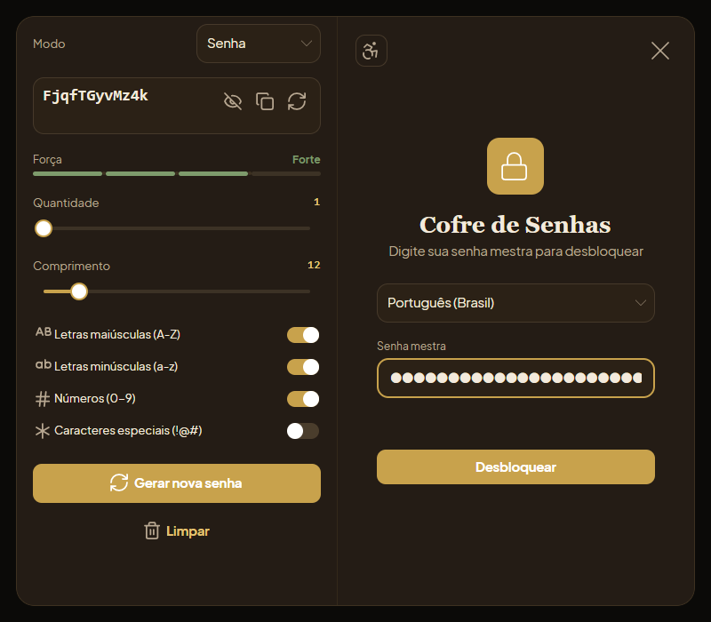

# Download e instalação

[← Voltar ao README](../README.md)

Passo a passo completo de instalação, desinstalação, CLI e verificação de
integridade.

A forma mais simples de usar o programa é baixar o executável pronto na página de
[releases](../../../releases). Em qualquer plataforma, o binário é autocontido: não
é necessário instalar o .NET nem qualquer dependência. Os binários do Windows
ainda não têm certificado de assinatura de código (Authenticode) — veja em
[SECURITY.md](../SECURITY.md#confiança-nos-binários-e-verificação-dos-downloads)
o porquê e como verificar a autenticidade do que foi baixado.

## Windows

1. Acesse a [última release](../../../releases/latest).
2. Baixe o instalador `CofreDeSenhas-Setup-*.exe`.
3. Execute e siga o assistente. Não é preciso ser administrador: por padrão o
   programa é instalado só para o usuário atual, com atalho no menu iniciar
   (e, opcionalmente, na área de trabalho) e entrada em "Aplicativos e
   recursos" para desinstalar depois.
4. Se preferir não instalar nada, o executável autocontido `CofreDeSenhas.exe`
   (sem instalador) também fica disponível na página da release — é só
   baixar e executar.

Quem só quer gerar senhas, sem abrir o cofre, pode baixar
`GeradorDeSenhas-*-win-x64-portatil.exe` na mesma [página de
releases](../../../releases/latest): é o mesmo gerador do Cofre, num executável
autocontido à parte, sem instalador e sem nenhuma das regras do cofre (sem
senha mestra, sem salvar nada).

Para desinstalar, use "Aplicativos e recursos" do Windows (ou o atalho
"Desinstalar Cofre de Senhas" no menu iniciar). O cofre em
`%APPDATA%\GerenciadorSenhas` é preservado por padrão; o desinstalador
pergunta explicitamente se você também quer apagar esses dados, com a opção
padrão sendo manter.

## Linha de comando (`cofre`)

Cada release também traz `cofre` — um executável de linha de comando
**somente-leitura** (`cofre-*-win-x64.exe` / `cofre-*-linux-x64`), para
automação e uso por teclado, sem abrir a janela:

```
cofre listar
cofre buscar github
cofre mostrar "Banco do Brasil"
cofre copiar github            # põe a senha na área de transferência e a apaga depois
cofre gerar --frase --palavras 5
```

A senha mestra é pedida no terminal a cada comando que abre o cofre; nada é
armazenado, e o bloqueio por tentativas erradas é o mesmo do aplicativo. O CLI
nunca imprime uma senha do cofre — ela só sai pela área de transferência. Não
cria nem edita credenciais (isso é só pelo aplicativo). Aponta para o mesmo
cofre do app; `COFRE_BASE=<pasta>` usa outro. Veja `cofre --help`.

Cada release gera também os manifests necessários para publicação no
`winget` (gerenciador de pacotes do Windows), como um passo em direção a
`winget install` — a submissão a `microsoft/winget-pkgs` ainda não foi
feita, então por enquanto o instalador da página de releases continua sendo
a forma de instalar.

## Linux

A forma mais simples é o **AppImage**: baixe
`CofreDeSenhas-*-x86_64.AppImage` na [última release](../../../releases/latest),
dê permissão de execução e rode — não precisa instalar o .NET nem nada além
disso:

```
chmod +x CofreDeSenhas-*-x86_64.AppImage
./CofreDeSenhas-*-x86_64.AppImage
```

Funciona em qualquer distribuição x86_64 recente, com integração automática de
ícone e atalho de menu se você usar um integrador de AppImage (AppImageLauncher,
Gear Lever etc.); sem um, basta executar o arquivo diretamente. O AppImage
também pode ser gerado localmente com `App/distribuicao/gerar-appimage.sh`
(com o .NET 10 SDK e `appimagetool` disponíveis).

Quem preferir compilar a partir do código-fonte, ou quer o atalho no menu de
aplicativos sem depender de um integrador de AppImage, pode usar o script de
instalação, que exige o .NET 10 SDK instalado e compila, publica e registra o
aplicativo para o usuário atual (sem sudo):

```
./App/distribuicao/instalar.sh
```

O script publica o binário em `~/.local/opt/cofre-de-senhas`, registra o atalho
"Cofre de Senhas" no menu de aplicativos e instala o ícone. Para remover,
execute `./App/distribuicao/desinstalar.sh` (o cofre em
`~/.config/GerenciadorSenhas` é preservado). Tanto o AppImage quanto o script
funcionam em ambientes X11 e Wayland.

Pacotes `.deb` e Flatpak foram avaliados e ficaram de fora por enquanto: exigem
manter um repositório próprio (ou publicação no Flathub) para atualizações
automáticas, o que não compensa o esforço com um único mantenedor e o AppImage
já cobre o caso de uso de "baixar e rodar" sem depender de gerenciador de
pacotes. Fica como possibilidade futura se houver demanda.

## Primeiro uso

Na tela de senha mestra, o gerador fica à esquerda e o desbloqueio à direita, com
seletor de idioma e, no Windows, a opção de desbloqueio por Windows Hello:



No primeiro uso, o programa pedirá a criação de uma senha mestra. Guarde-a com
cuidado: ela é a única forma de abrir o cofre. Um cofre exportado (`.gsenhas`)
em uma plataforma pode ser importado na outra. Se este é um dispositivo novo e
o cofre já é compartilhado através de um banco de dados externo, a mesma tela
oferece "Restaurar de um banco de dados": basta digitar a senha mestra já em
uso para trazer o cofre inteiro daquele banco, sem precisar recriar nada.

## Verificando a integridade dos arquivos

Toda release inclui um `CHECKSUMS.txt` com o hash SHA256 de cada arquivo
disponibilizado. Depois de baixar, é possível conferir que o arquivo não foi
alterado no caminho:

```
# Windows (PowerShell)
Get-FileHash .\arquivo-baixado -Algorithm SHA256

# Linux / macOS (na pasta onde os arquivos foram baixados)
sha256sum -c CHECKSUMS.txt
```

Compare o valor calculado com o que consta em `CHECKSUMS.txt`.

Cada arquivo publicado também tem uma *attestation*
de proveniência (SLSA/Sigstore) — uma prova assinada de que aquele arquivo
exato foi gerado pelo workflow de release deste repositório, a partir de um
commit específico, e não montado ou alterado por fora dele. É uma garantia
mais forte que o hash sozinho: o hash prova que o arquivo não mudou desde que
foi publicado, a attestation prova de onde ele veio. Conferir exige o
[GitHub CLI](https://cli.github.com/):

```
gh attestation verify arquivo-baixado --owner dcCarreto
```

Os arquivos ainda não são assinados digitalmente (Authenticode, no caso do
Windows) — por ora, hash + attestation são as formas de verificação
disponíveis. Veja também a [verificação com assinatura
RSA/GPG](../SECURITY.md#confiança-nos-binários-e-verificação-dos-downloads)
usada pelo atualizador automático.
