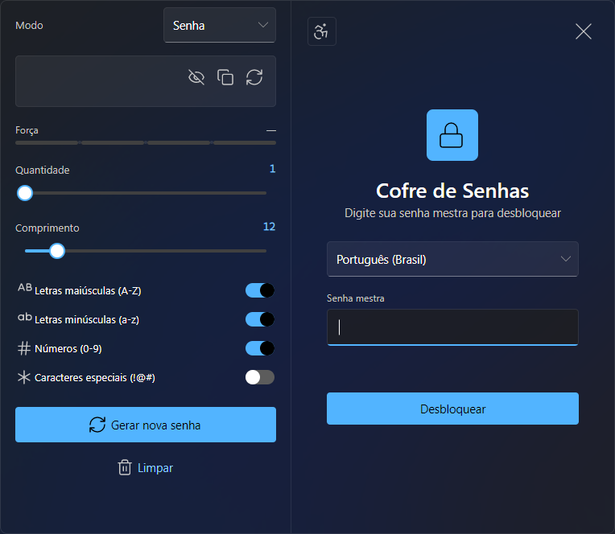

# Download e instalação

[← Voltar ao README](../README.md)

Passo a passo completo de instalação, atualização, desinstalação, CLI e
verificação de integridade.

A forma mais simples de usar o programa é baixar o executável pronto na página de
[releases](https://github.com/dcCarreto/CofreDeSenhas/releases). Em qualquer plataforma, o binário é autocontido: não
é necessário instalar o .NET nem qualquer dependência. Os binários do Windows
ainda não têm certificado de assinatura de código (Authenticode) — veja em
[SECURITY.md](../SECURITY.md#confiança-nos-binários-e-verificação-dos-downloads)
o porquê e como verificar a autenticidade do que foi baixado.

## Windows

O jeito mais rápido é pelo `winget` (gerenciador de pacotes do Windows), num
terminal:

```
winget install dcCarreto.CofreDeSenhas
```

Ele baixa da página de releases o mesmo instalador descrito abaixo, confere o
SHA256 e instala só para o usuário atual, sem pedir administrador. Para
atualizar não é preciso fazer nada: o próprio programa baixa as versões novas
e as instala quando o cofre é bloqueado. `winget upgrade dcCarreto.CofreDeSenhas` também funciona. O pacote no `winget`
costuma chegar algumas horas depois de cada release, porque cada versão passa
pela validação da Microsoft.

Para instalar sem o `winget`:

1. Acesse a [última release](https://github.com/dcCarreto/CofreDeSenhas/releases/latest).
2. Baixe o instalador `CofreDeSenhas-Setup-*.exe`.
3. Execute e siga o assistente. Não é preciso ser administrador: por padrão o
   programa é instalado só para o usuário atual, com atalho no menu iniciar
   (e, opcionalmente, na área de trabalho) e entrada em "Aplicativos e
   recursos" para desinstalar depois.

A versão portátil (`CofreDeSenhas-*-win-x64-portatil.exe`, sem instalador) foi
descontinuada. Quem ainda a usa não precisa fazer nada: na próxima atualização
ela instala o programa só para o usuário atual, sem pedir administrador, com o
mesmo cofre e as mesmas preferências. O `.exe` portátil continua funcionando
como atalho, abrindo a versão instalada, e pode ser apagado. O arquivo ainda
aparece nas releases por um tempo, só para as cópias antigas conseguirem se
atualizar.

Quem só quer gerar senhas, sem abrir o cofre, pode baixar
`GeradorDeSenhas-*-win-x64.exe` na mesma [página de
releases](https://github.com/dcCarreto/CofreDeSenhas/releases/latest): é o mesmo gerador do Cofre, num executável
autocontido à parte, sem instalador e sem nenhuma das regras do cofre (sem
senha mestra, sem salvar nada).

Para desinstalar, use "Aplicativos e recursos" do Windows (ou o atalho
"Desinstalar Cofre de Senhas" no menu iniciar). O cofre em
`%APPDATA%\GerenciadorSenhas` é preservado por padrão; o desinstalador
pergunta explicitamente se você também quer apagar esses dados, com a opção
padrão sendo manter.

## Linha de comando (`cofre`)

Cada release também traz `cofre` — um executável de linha de comando
**somente-leitura** (`cofre-*-win-x64.exe` / `cofre-*-linux-x64`), para
automação e uso por teclado, sem abrir a janela:

```
cofre listar
cofre buscar github
cofre mostrar "Banco do Brasil"
cofre copiar github            # põe a senha na área de transferência e a apaga depois
cofre gerar --frase --palavras 5
```

A senha mestra é pedida no terminal a cada comando que abre o cofre; nada é
armazenado, e o bloqueio por tentativas erradas é o mesmo do aplicativo. O CLI
nunca imprime uma senha do cofre — ela só sai pela área de transferência. Não
cria nem edita credenciais (isso é só pelo aplicativo). Aponta para o mesmo
cofre do app; `COFRE_BASE=<pasta>` usa outro. Veja `cofre --help`.

Cada execução do workflow de release gera também os manifests do `winget`
(artefato `winget-manifests-*` do workflow, fora da release) e, depois de
publicar a release, abre sozinha o PR no
[`microsoft/winget-pkgs`](https://github.com/microsoft/winget-pkgs/tree/master/manifests/d/dcCarreto/CofreDeSenhas)
com `.github/scripts/enviar_winget.sh` (precisa do secret `WINGET_TOKEN`: um
token clássico com o escopo `public_repo`; sem ele o passo é pulado).

## Arquivos de cada release

O fim das notas de cada release traz esta mesma lista. Para instalar, só
importam as três primeiras linhas.

| Arquivo | O que é |
|---|---|
| `CofreDeSenhas-Setup-*.exe` | Instalador do Windows. É o que o `winget` usa. |
| `cofre-de-senhas_*_amd64.deb` | O aplicativo para Linux Mint, Ubuntu, Debian e derivados (dois cliques para instalar). |
| `CofreDeSenhas-*-x86_64.AppImage` | O aplicativo para as outras distribuições Linux. |
| `GeradorDeSenhas-*-win-x64.exe` | Só o gerador de senhas, sem o cofre (Windows, avulso). |
| `cofre-*-win-x64.exe` / `cofre-*-linux-x64` | A [linha de comando `cofre`](#linha-de-comando-cofre). |
| `CofreDeSenhas-*-win-x64-portatil.exe` | Portátil descontinuado; fica só para as cópias antigas se atualizarem. |
| `CHECKSUMS.txt` e `CHECKSUMS.txt.sig` | Hash SHA-256 de cada arquivo e a assinatura dessa lista ([como conferir](#verificando-a-integridade-dos-arquivos)). |
| `CofreDeSenhas-*-sbom.json` | Lista das bibliotecas usadas na versão (SBOM, CycloneDX). |

## Linux

No **Linux Mint, Ubuntu, Debian e derivados**, baixe
`cofre-de-senhas_*_amd64.deb` na [última release](https://github.com/dcCarreto/CofreDeSenhas/releases/latest)
e clique duas vezes nele. O instalador de pacotes do sistema abre, pede a sua
senha uma vez e instala o app em `/opt/cofre-de-senhas`, com o atalho "Cofre de
Senhas" no menu de aplicativos. Não precisa instalar o .NET nem nada além disso.
Pelo terminal, o equivalente é:

```
sudo apt install ./cofre-de-senhas_*_amd64.deb
```

Depois disso o app se atualiza sozinho, sem pedir a senha de novo: o pacote
instala uma regra do polkit que deixa a sessão ativa rodar **só** o
`/opt/cofre-de-senhas/atualizar-pacote`, e esse ajudante só instala um pacote
de uma release assinada pela chave do projeto e mais novo que o instalado
(detalhes no [modelo de ameaça](../THREAT_MODEL.md)). Para remover:
`sudo apt remove cofre-de-senhas` (o cofre em `~/.config/GerenciadorSenhas` é
preservado).

Nas **outras distribuições**, use o **AppImage**: baixe
`CofreDeSenhas-*-x86_64.AppImage`, dê permissão de execução e rode:

```
chmod +x CofreDeSenhas-*-x86_64.AppImage
./CofreDeSenhas-*-x86_64.AppImage
```

Funciona em qualquer distribuição x86_64 recente. Na primeira execução o app
se registra no menu de aplicativos (atalho "Cofre de Senhas" e ícone em
`~/.local/share`, sem sudo); daí em diante basta abri-lo pelo menu. O atalho
aponta para o arquivo `.AppImage` onde ele estiver: se você movê-lo, abra-o uma
vez pelo novo lugar e o atalho é corrigido; se apagá-lo, o atalho some do menu.
Se você usa um integrador de AppImage (AppImageLauncher, Gear Lever etc.), o
atalho dele é mantido e o do app não é criado, para não duplicar a entrada. O
AppImage também pode ser gerado localmente com
`App/distribuicao/gerar-appimage.sh` (com o .NET 10 SDK e `appimagetool`
disponíveis).

Quem preferir compilar a partir do código-fonte pode usar o script de
instalação, que exige o .NET 10 SDK instalado e compila, publica e registra o
aplicativo para o usuário atual (sem sudo):

```
./App/distribuicao/instalar.sh
```

O script publica o binário em `~/.local/opt/cofre-de-senhas`, registra o atalho
"Cofre de Senhas" no menu de aplicativos e instala o ícone. Para remover,
execute `./App/distribuicao/desinstalar.sh` (o cofre em
`~/.config/GerenciadorSenhas` é preservado). Tanto o AppImage quanto o script
funcionam em ambientes X11 e Wayland.

Pacotes `.deb` e Flatpak foram avaliados e ficaram de fora por enquanto: exigem
manter um repositório próprio (ou publicação no Flathub) para atualizações
automáticas, o que não compensa o esforço com um único mantenedor, e o AppImage
já cobre o caso de uso de "baixar e rodar" — e se atualiza sozinho — sem
depender de gerenciador de pacotes. Fica como possibilidade futura se houver
demanda.

## Atualizações

O programa se atualiza sozinho, sem você precisar baixar nem clicar em nada:

1. Ao abrir o cofre, e depois a cada 6 horas, ele consulta a última release no
   GitHub.
2. Havendo versão nova, baixa em segundo plano e confere a assinatura do
   `CHECKSUMS.txt` e o SHA256 do arquivo (detalhes em
   [SECURITY.md](../SECURITY.md#confiança-nos-binários-e-verificação-dos-downloads)).
   Se algo não conferir, a atualização é descartada.
3. O rodapé passa a mostrar "Atualização pronta". No próximo bloqueio do cofre
   (manual ou por inatividade), o programa fecha, instala a versão nova e abre
   de novo, já na tela de desbloqueio. O botão **Instalar agora** do rodapé
   antecipa, mostrando antes o que muda na versão.

Não há opção para desligar. Quem já usava o programa antes dessa mudança
(quando a verificação era opcional e só avisava, ou quando ainda dava para
desligar e estava desligada) passa a ter a atualização automática ligada e vê
um aviso no rodapé na primeira abertura.

| Instalado por | Como atualiza |
|---|---|
| Instalador ou `winget` | Sozinho. Se você instalou "para todos os usuários" (em Arquivos de Programas), o Windows pede permissão de administrador: clique em **Instalar agora** quando o rodapé avisar. `winget upgrade dcCarreto.CofreDeSenhas` também funciona. |
| Executável portátil (descontinuado) | Na próxima atualização, passa para a versão instalada (só para o usuário atual, sem pedir administrador). Depois disso, o `.exe` portátil só abre a versão instalada. |
| Pacote `.deb` (Linux) | Sozinho, sem pedir senha; o pacote novo é instalado por cima. |
| AppImage (Linux) | Sozinho; o `.AppImage` é trocado pelo novo. |
| `instalar.sh` (Linux, compilando do código-fonte) | Manualmente: atualize o repositório e rode `instalar.sh` de novo. |
| Linha de comando `cofre` e gerador avulso | Manualmente: são arquivos à parte; baixe as versões novas na [página de releases](https://github.com/dcCarreto/CofreDeSenhas/releases/latest). |

A atualização não toca no cofre, nos backups nem nas preferências. O arquivo
baixado fica na pasta temporária do sistema até ser instalado e é apagado na
abertura seguinte do programa — veja [Armazenamento de dados](ARMAZENAMENTO.md).

## Primeiro uso

Na tela de senha mestra, o gerador fica à esquerda e o desbloqueio à direita, com
seletor de idioma e, no Windows, a opção de desbloqueio por Windows Hello:



No primeiro uso, o programa pedirá a criação de uma senha mestra. Guarde-a com
cuidado: ela é a única forma de abrir o cofre. Um cofre exportado (`.gsenhas`)
em uma plataforma pode ser importado na outra. Se este é um dispositivo novo e
o cofre já é compartilhado através de um banco de dados externo, a mesma tela
oferece "Restaurar de um banco de dados": basta digitar a senha mestra já em
uso para trazer o cofre inteiro daquele banco, sem precisar recriar nada.

## Verificando a integridade dos arquivos

Toda release inclui um `CHECKSUMS.txt` com o hash SHA256 de cada arquivo
disponibilizado. Depois de baixar, é possível conferir que o arquivo não foi
alterado no caminho:

```
# Windows (PowerShell)
Get-FileHash .\arquivo-baixado -Algorithm SHA256

# Linux / macOS (na pasta onde os arquivos foram baixados)
sha256sum -c CHECKSUMS.txt
```

Compare o valor calculado com o que consta em `CHECKSUMS.txt`.

Cada arquivo publicado também tem uma *attestation*
de proveniência (SLSA/Sigstore) — uma prova assinada de que aquele arquivo
exato foi gerado pelo workflow de release deste repositório, a partir de um
commit específico, e não montado ou alterado por fora dele. É uma garantia
mais forte que o hash sozinho: o hash prova que o arquivo não mudou desde que
foi publicado, a attestation prova de onde ele veio. Conferir exige o
[GitHub CLI](https://cli.github.com/):

```
gh attestation verify arquivo-baixado --owner dcCarreto
```

Os arquivos ainda não são assinados digitalmente (Authenticode, no caso do
Windows) — por ora, hash + attestation são as formas de verificação
disponíveis. Veja também a [verificação da assinatura
RSA](../SECURITY.md#confiança-nos-binários-e-verificação-dos-downloads)
usada pelo atualizador automático.
